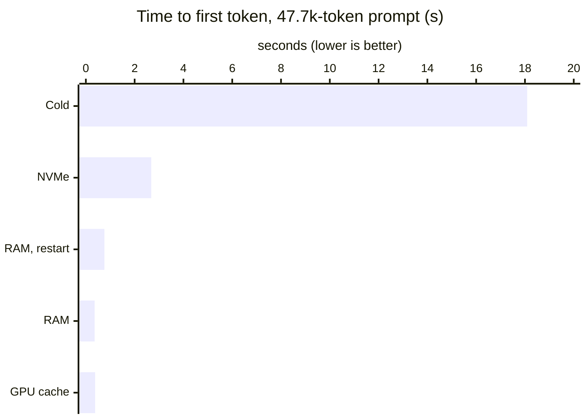

<h1 align="center">GLM-5.3-Flash on 4× NVIDIA CMP 170HX</h1>

<p align="center">
  <strong>by <a href="https://x.com/Morrowmake">Morrowmake</a></strong>
  <br><br>
  <a href="https://x.com/Morrowmake"></a>
  &nbsp;
  <a href="https://github.com/Morrowmake/vllm-cmp170hx/tree/819146023facb31c04f1f8512e52464835a10d40"></a>
  &nbsp;
  
  &nbsp;
  
</p>

> **Fork of [Morrowmake/glm53-flash-cmp170hx-recipe](https://github.com/Morrowmake/glm53-flash-cmp170hx-recipe)
> with faster restarts** (252 s → ~150 s on TP4) and measurements up to 16 users,
> with a LoRA adapter and with an LMCache KV tier in RAM and on NVMe. Everything
> this fork found is in [Fork findings](#fork-findings); the rest of this README
> is the upstream text and its 1.8.0 numbers.

**A 320B-parameter MoE with a 262,144-token context, served on four CMP 170HX
cards in two layouts. Release 1.8.0 tensor-parallel results with verified peer-to-peer at 74 SMs:
482.6 tok/s for one user and 943.7 tok/s across eight,
3,161 tok/s cold prefill and a 1,203,765-token KV pool. The weights
are W4A16 and nothing else is cut: the KV cache is full precision, there is no
FP8 anywhere, and nothing is offloaded to CPU or disk.**

This repository installs and runs **GLM-5.3-Flash** on **four NVIDIA CMP 170HX
cards** behind an OpenAI-compatible API, with tool calls, reasoning, images and
video, and a **DFlash2** speculative drafter. Upstream vLLM's sparse-attention
path needs a Hopper GPU; the CMP 170HX is Ampere (sm_80). Our
[vLLM fork](https://github.com/Morrowmake/vllm-cmp170hx/tree/ampere) adds
the Ampere kernels that make the model run at all, then spends the rest of its
patches on making it fast and making it repeatable. It runs only as a container
image, so the engine and its Python environment stay out of your system.
P2P is enabled automatically after a startup [content check](docs/how-to-use.md#pcie-peer-to-peer) passes; otherwise the server runs with P2P disabled.

Also on these cards: [DeepSeek-V4.1-Flash on four CMP 170HX](https://github.com/Morrowmake/dsv41-flash-cmp170hx-recipe).

## Quick start

One command from a fresh clone, after the [one-time host setup](#one-time-host-setup):

```bash
git clone https://github.com/Morrowmake/glm53-flash-cmp170hx-recipe.git
cd glm53-flash-cmp170hx-recipe
./start.sh          # pull the engine image, fetch the model, start, wait for /health
```

Then try it:

```bash
./start.sh smoke    # one chat request and one tool call
curl http://127.0.0.1:8000/v1/chat/completions \
  -H 'Content-Type: application/json' \
  -d '{"model": "glm-5.3-flash",
       "messages": [{"role": "user", "content": "Write a haiku about PCIe."}],
       "max_tokens": 4096}'
```

> **GLM-5.3 always reasons before it answers.** The reasoning comes back in the
> message's `reasoning` field and the answer in `content`. **Set `max_tokens`
> for the reasoning plus the answer:** if the limit is reached while the model
> is still reasoning, `content` comes back empty with `finish_reason: "length"`.
> `"chat_template_kwargs": {"enable_thinking": false}` has no effect; use
> `reasoning_effort` (`low`, `high`, `max`) to shorten the reasoning
> ([Talk to it](docs/how-to-use.md#talk-to-it)).

`./start.sh` skips anything already done, so running it twice is safe; an
interrupted download resumes. The image ships no warm-cache seed: it starts
compile on first boot (cold), so the first start is slower; later starts reuse
the compiled kernels in `./cache`.
Any OpenAI-compatible client works with base URL `http://127.0.0.1:8000/v1`
and model `glm-5.3-flash`. The API listens on this machine only and has no
API key unless you [change that](docs/how-to-use.md#serving-other-machines).
Python, streaming and tool-call clients are in [examples/](examples/README.md).

**Prefer Docker Compose?** The same container, also one command from a fresh
clone:

```bash
docker compose up              # or in the background: docker compose up -d
```

It downloads the checkpoints, then starts the server as the owner of the
checkout; `docker compose ps` shows it healthy once `/health` answers
([Docker Compose](docs/how-to-use.md#docker-compose)). Compose restarts a
crashed server up to 3 times; `./start.sh` does not (run `./start.sh restart`).
Use one or the other.

Both download the checkpoints at the exact Hugging Face revisions this release
was validated with.

> **Which setups this release is for.** Two layouts, one switch
> (`LAYOUT=tp4` or `LAYOUT=pp4`):
>
> - **Tensor-parallel 4** (the default) is optimised for **PCIe x16 links** —
>   cards with the x16 capacitor modification. It gives each request the
>   fastest answer. On cards limited to x4 links it is bus-bound and much
>   slower.
> - **Pipeline-parallel 4** passes only activations between the cards, so it
>   needs far less link bandwidth; it is the layout **for cards limited to x4
>   links**, and for many parallel users and long prompts. Performance on x4
>   links has not yet been measured.
>
> `./start.sh` checks your link width and suggests `LAYOUT=pp4` if a card is
> narrower than x16.

## One-time host setup

- **4× NVIDIA CMP 170HX, each exposing 64 GiB**; **PCIe Gen2 x16 links** for
  tensor-parallel 4 (pipeline-parallel 4 is built for narrower links)
- Linux with NVIDIA driver **580 or newer**
- Docker with the [NVIDIA Container Toolkit](https://docs.nvidia.com/datacenter/cloud-native/container-toolkit/latest/install-guide.html),
  usable by your user: `docker run --rm --gpus all nvidia/cuda:13.3.1-base-ubuntu24.04 nvidia-smi`
  lists all four cards
- optional: a P2P-capable driver build for verified peer-to-peer
  ([PCIe peer-to-peer](docs/how-to-use.md#pcie-peer-to-peer)); without it the
  server runs with P2P disabled
- for `./start.sh`: `git`, `curl`, `flock`, `setsid`, Python 3 for the boot
  check, and `jq` for the smoke test
- about 180 GiB (193 GB) of disk for the two checkpoints, plus the engine image
  and the kernel compile caches ([details](docs/how-to-use.md#what-you-need))

## Headline numbers

Measured 2026-10-16 on 4× CMP 170HX, 74 SMs per card, mainline cmpunlocker
with P2P, recipe defaults, 262,144-token context, 180 W per card and PCIe x16 links.
Decode uses the MiaAI-Lab protocol: 400 tokens, temperature 0, requests sent with
thinking off (GLM-5.3 reasons regardless; reasoning tokens count); one user is
the median of five runs, and two, four and eight users the median aggregate
rate of three runs, each layout on one boot.

| | Tensor-parallel 4<br>+ [peer-to-peer](docs/how-to-use.md#pcie-peer-to-peer) (default after verification) | Pipeline-parallel 4<br>+ [peer-to-peer](docs/how-to-use.md#pcie-peer-to-peer) |
|---|---:|---:|
| **1 user** · structured | **482.6** | 232.4 |
| **1 user** · code | **442.1** | 209.9 |
| **1 user** · prose | **232.1** | 100.1 |
| **2 users, total** · structured | 606.5 | 343.8 |
| **2 users, total** · code | 460.3 | 273.4 |
| **2 users, total** · prose | 314.7 | 195.5 |
| **4 users, total** · structured | 717.7 | 409.2 |
| **4 users, total** · code | 618.7 | 382.8 |
| **4 users, total** · prose | 501.4 | 314.2 |
| **8 users, total** · structured | **943.7** | 664.1 |
| **8 users, total** · code | **835.0** | 608.8 |
| **8 users, total** · prose | **667.2** | 469.2 |
| **Prompt reading** (cold prefill) | 3,161 | **7,419** |
| **KV pool** (tokens) | 1,203,765 | **2,088,960** |

All rates are up-to figures in tok/s. One user is streaming speed per request; two, four and
eight users are the combined rate of that many simultaneous requests.
Structured output and code are drafted well, so they decode fastest; prose
least. DFlash2 drafts up to 7 tokens ahead for one user and 3 under load.
One-user prose varies most between runs. Both layouts were measured on PCIe x16
links. Quality on the final release build, scored on the answer after the
reasoning: TP4 HumanEval 151/164 and GSM8K 1,286/1,319.
Method and exact figures: [Results](docs/results.md).

## Fork findings

Measured 2026-11-10 on 4× CMP 170HX at 200 W per card, PCIe Gen2 x16,
verified P2P, TP4, DFlash2, `MAX_SEQS=16`, `GPU_UTIL=0.95`, with the same
engine and image as 1.8.0. Decode uses the same MiaAI-Lab script and protocol
as the table above (400 tokens, temperature 0, thinking off; one user is the
median streaming rate of five runs, N users the median aggregate of three).

### Throughput, up to 16 users

| tok/s · structured / code / prose | 1.8.0 (table above) | This fork's run, base model | Same, with a LoRA adapter |
|---|---:|---:|---:|
| **1 user** | 482.6 / 442.1 / 232.1 | **530.0** / 408.5 / 212.1 | 431.2 / 329.5 / 191.4 |
| **2 users, total** | 606.5 / 460.3 / 314.7 | **631.3 / 503.7 / 358.1** | 537.6 / 431.7 / 311.5 |
| **4 users, total** | 717.7 / 618.7 / 501.4 | **818.0 / 685.3 / 548.6** | 680.4 / 567.6 / 443.0 |
| **8 users, total** | 943.7 / 835.0 / 667.2 | **1,158.0 / 1,007.1 / 729.5** | 975.9 / 804.5 / 624.3 |
| **16 users, total** | — | **1,200.9 / 1,020.6 / 777.4** | 1,124.1 / 939.4 / 731.9 |
| **Cold prefill** | 3,161 | 3,141 (2,565 with LMCache) | 2,554 with LMCache |

- The fork changes only how the server starts, so decode differences against
  1.8.0 come from the host (power limit, CPU), not from the patches.
- **16 users add only ~4 % over 8** (structured): the cards are compute-bound
  by 8 users. More concurrency mostly adds latency per request.
- **A LoRA adapter costs 10–20 % of decode** (rank 1 on `o_proj`, `down_proj`
  and the experts); prefill is unchanged.
- Cold prefill here uses three synthetic ~67k-token prompts with fresh
  prefixes (the release's real-text prompts are not published), median of nine.

### Restarts: 252 s → ~150 s

| From `restart` to `/health` 200 (TP4, base model, weights in page cache) | Time |
|---|---:|
| Release behaviour | 252 s |
| With this fork | **147–155 s** |

| Change | Saves per start |
|---|---:|
| Four workers started together instead of one after another ([patch](patches/README.md)) | ~45 s |
| Bytecode cache (`PYTHONPYCACHEPREFIX=/cache/pycache`): the image ships vLLM without `.pyc`, so every process compiled it on every start | ~8 s per process stage |
| Startup plan on (`VLLM_ENABLE_STARTUP_PLAN=1`), fixed so all ranks agree and with a 512 MiB margin | engine init 63 s → 39 s |

- **Startup plan bug in the release engine:** each rank decided alone whether
  to use its saved plan. When free memory differed slightly between cards, one
  rank skipped profiling while the others profiled and **the engine hung**.
  The patch makes the ranks agree; tested with one rank's plan made unusable.
- **Cost:** a start that uses a plan has a 7 % smaller KV pool (992,941 instead
  of 1,066,492 tokens). `VLLM_ENABLE_STARTUP_PLAN=0` keeps the full pool;
  `ENGINE_PATCHES=0` removes both patches.
- Still in the ~150 s: weight loading (~35 s from page cache, ~100 s cold),
  profiling and CUDA-graph capture (~40 s), Python start-up of three process
  stages (~9 s each) and the P2P check.

### LMCache: KV cache in RAM and on NVMe that survives restarts

Optional, not in the default start; setup in [docs/lmcache.md](docs/lmcache.md).
Same ~47,700-token prompt asked again:



Cold: nothing cached · NVMe: LMCache server and vLLM both restarted ·
RAM, restart: vLLM restarted, LMCache kept running · RAM: GPU cache cleared ·
GPU cache: prefix still in vLLM's GPU cache.

| Situation | Time to first token | vs cold |
|---|---:|---:|
| Cold, nothing cached | 18.09 s | 1× |
| Prefix still in vLLM's GPU cache | 0.38 s | 48× |
| GPU cache cleared, served from LMCache RAM | **0.36 s** | **50×** |
| vLLM restarted, LMCache server kept running | **0.76 s** | **24×** |
| LMCache server and vLLM both restarted (NVMe only) | **2.68 s** | **6.8×** |

- **Cost:** −18 % cold prefill (every prefilled chunk is also written to RAM);
  decode unchanged (1 / 16 users: 175 / 628 vs 170 / 633 tok/s on our own
  prompts); host RAM for the RAM tier (64–128 GB here) plus ~16 GB.
- Compared with vLLM's built-in CPU offload, the RAM belongs to a separate
  server, so it survives vLLM restarts and vLLM no longer pins it at every
  start (~100 s for 128 GiB on our host).
- Must use `LMCacheMPConnector`: the in-process `LMCacheConnectorV1` fails on
  this hybrid KDA + MLA model. `--chunk-size` must be a multiple of 1,152.
  `--l2-prefetch-policy retain` keeps NVMe reads in RAM (the default drops them).
- **LoRA:** LMCache keys the cache by tokens only. Serving a base model and a
  LoRA adapter from one server shares their KV unless the adapter name is
  added to the cache salt (see [docs/lmcache.md](docs/lmcache.md)).

### P2P on AMD hosts: `iommu=pt`

If P2P passes on a fresh boot but **fails after every server stop or crash**
(`cudaMemcpyPeer mismatch`, NCCL hangs) and only a reboot helps, check
`dmesg` for `AMD-Vi ... IO_PAGE_FAULT` from the GPUs. With the IOMMU in
translated mode, peer DMA uses mappings that a process exit tears down. The
kernel parameter **`iommu=pt`** fixes it: after the change, stops, crashes and
restarts keep P2P working with zero `IO_PAGE_FAULT`
([details](docs/how-to-use.md#pcie-peer-to-peer)). Seen on EPYC 7003.

### Tried and not usable on this model

| Idea | Result |
|---|---|
| **Decode context parallel** (`--decode-context-parallel-size 4`) | Refused at start: no sparse-MLA attention backend supports DCP on sm80. Little to gain anyway: only 11 of 45 layers are MLA, the KV pool is not the limit, and the extra collectives would run over PCIe. |
| **CacheBlend** (reusing KV of non-prefix chunks) | Not applicable: 34 of 45 layers are recurrent KDA, whose state depends on the whole prefix. Blending only the 11 attention layers would still recompute every token through the KDA and MoE layers. |
| **LMCache in-process connector** (`LMCacheConnectorV1`) | Fails on the hybrid model (no HMA support); the multi-process connector works. |

## Settings

Settings live in `.env`; see [Settings](docs/how-to-use.md#settings)
for boot checks and default reasoning effort.

## Choosing a layout

Tensor-parallel 4 (`tp4`, the default) gives one or two interactive users the
fastest answer per request and needs x16 links. Pipeline-parallel 4 (`pp4`)
suits many parallel users, long prompts and x4 links, with higher cold prefill
throughput and a larger KV pool ([Results](docs/results.md)). Switch with `LAYOUT=pp4 ./start.sh restart` (or set it
in `.env`); details in [Choosing a layout](docs/results.md#choosing-a-layout).

## Documentation

- [Results](docs/results.md): throughput, quality, decode and prefill in detail
- Fork: [engine patches for faster restarts](patches/README.md), [LMCache in RAM and on NVMe](docs/lmcache.md),
  [fork measurements](docs/results.md#fork-measurements-2026-11-10)
- [How to use this repo](docs/how-to-use.md): install, settings, peer-to-peer,
  kill switches, day to day, updates, Docker Compose, containers
- [Optional compiled Marlin](docs/compiled-marlin.md): defaults, switches, building it
- [How it works](docs/how-it-works.md): what makes it fast and correct, and what runs
- [Engine switches](docs/engine-switches.md): the engine's internal switches, for troubleshooting
- [Status and known limits](docs/known-limits.md)
- [Model licences](docs/model-licences.md): complete target-model MIT notice,
  drafter restrictions and method citations
- [Examples](examples/README.md): curl, Python, streaming, tool calls, layout `.env` files
- [Container image](docker/README.md) and [CHANGELOG.md](CHANGELOG.md)
- Found a problem? [Open an issue](https://github.com/Morrowmake/glm53-flash-cmp170hx-recipe/issues/new/choose);
  the bug template asks for the version, layout, peer-to-peer setting and log lines we need

## Update

- `./start.sh update` pulls the new release and engine image and restarts; your `.env` is preserved.
  A checkout that ran the engine natively under an earlier release moves to the
  container on the same `.env` and checkpoints ([details](docs/how-to-use.md#day-to-day)).
- With Compose: `git pull`, then `docker compose up -d`.
- Older releases are git tags; their images may be retired.

**Updating to 1.8.0 from 1.7.x:**

- **Size `max_tokens` for the reasoning plus the answer.** GLM-5.3 always
  reasons; this engine returns the reasoning in `reasoning` and the answer in
  `content`. A reply that hits the limit while still reasoning has an empty
  `content`. `enable_thinking: false` has no effect.
- In `.env`, delete any `VLLM_BRANCH=ampere-glm53` line (that branch is
  retired), any `IMAGE` or `VLLM_COMMIT` line (to follow this release's image),
  and an `EXTRA_ARGS` line carrying `max_pixels` and `max_image_tokens` if you
  added it for `MM_CAP=1` on 1.7.2.
- Engine switches have new names: rename any old `VLLM_GLM5_*` (or other
  renamed) line in `.env` or `docker/container.env`; old names are ignored
  with a warning at startup. Delete a `SPEC_N` line: with DFlash2 the server
  refuses it. The [CHANGELOG](CHANGELOG.md) lists every renamed and retired
  setting.
- Native installs need Docker and the NVIDIA Container Toolkit first; see the
  [CHANGELOG](CHANGELOG.md) for the `.env` lines to remove.

---

## Licences

**This recipe** — the scripts and the documentation — is MIT, © 2026 Morrowmake.
See [LICENSE](LICENSE).

**The vLLM fork** is [Apache-2.0](https://github.com/Morrowmake/vllm-cmp170hx/blob/819146023facb31c04f1f8512e52464835a10d40/LICENSE).

The downloaded models have separate licences:

- **Target:** [`canada-quant/GLM-5.3-Flash-W4A16-MTP`](https://huggingface.co/canada-quant/GLM-5.3-Flash-W4A16-MTP/blob/main/README.md)
  declares `license: mit` (MIT), inherited from the base model
  [`zai-org/GLM-5.3-Flash`](https://huggingface.co/zai-org/GLM-5.3-Flash/blob/main/LICENSE).
  Its card says: "Follow the base model's usage terms."
- **Default drafter:** [`incoai/GLM-5.3-Flash-DFlash2`](https://huggingface.co/incoai/GLM-5.3-Flash-DFlash2/blob/main/README.md)
  declares `license: cc-by-nc-nd-4.0` (CC BY-NC-ND 4.0). Its card says
  "for research and evaluation. For commercial licensing, contact contact@inco.ai."
  The [licence](https://creativecommons.org/licenses/by-nc-nd/4.0/) requires
  attribution, prohibits commercial use, and prohibits distributing modified material.

DFlash2 is the only supported speculative mode; every figure on this page uses
it. Its default checkpoint does not grant commercial-use permission: commercial
use requires a separate licence from incoai ([Known limits](docs/known-limits.md)).
The [model-licence reference](docs/model-licences.md) preserves the target's
complete inherited MIT notice and describes the separate checkpoint terms.

**The benchmark prompts** come from MiaAI-Lab's repository (AGPL-3.0) and
their sparkDash prompt constants (MIT), used as data with attribution. No code from their repositories is included here.

## Credits

If this recipe helps you, please credit Morrowmake and link this repository.
Citation metadata: [`CITATION.cff`](CITATION.cff).

- **[MiaAI-Lab](https://github.com/MiaAI-Lab/GLM-5.3-Flash-EXL3-2x-DGX-Sparks)**
  for publishing the benchmark prompts used in the decode tables.
- **[incoai](https://huggingface.co/incoai/GLM-5.3-Flash-DFlash2)** for the
  DFlash2 drafter checkpoint and [DFlash 2](https://inco.ai/blog/dflash2/).
  The original [DFlash](https://github.com/z-lab/dflash) method is by
  Jian Chen, Yesheng Liang and Zhijian Liu (ICML 2026).
- **[canada-quant](https://huggingface.co/canada-quant/GLM-5.3-Flash-W4A16-MTP)**
  for the W4A16 quantisation.
- **[Z.ai](https://huggingface.co/zai-org/GLM-5.3-Flash)** for GLM-5.3-Flash,
  and the **[vLLM](https://github.com/vllm-project/vllm)** project for the
  engine these patches sit on top of.

## Source

The fork contains our maintained changes, inherited upstream code and the
adaptations credited below —
[Morrowmake/vllm-cmp170hx @ `ampere`](https://github.com/Morrowmake/vllm-cmp170hx/tree/ampere).

## Acknowledgements

- Mainline [cmpunlocker](https://github.com/amoghmunikote/cmpunlocker) and its maintainer's P2P work, plus our minimal TRAP31 patch, form the basis of the P2P driver build. Ready to install: [Morrowmake/cmpunlocker](https://github.com/Morrowmake/cmpunlocker).
- Upstream [vLLM](https://github.com/vllm-project/vllm) provides the
  [RecoverSSM implementation](https://github.com/vllm-project/vllm/commit/70afdedc1081d28c3eaae53bece8292298484c86)
  and fixes we build on.
- [MiaAI-Lab's GLM-5.3-Flash recipe](https://github.com/MiaAI-Lab/GLM-5.3-Flash-EXL3-2x-DGX-Sparks/tree/6278ecb01034cea9ef6de0f851d09fccafe3e835)
  provided ideas for tool-call masking, the startup boot check, cached
  prompt-boundary reuse and scheduler back-off, Mamba in-flight reservation,
  the image layer-count guard and the default reasoning-effort setting.
  These are idea credits, not a claim that we imported its AGPL implementation.
- [wtdcode/vllm-backport](https://github.com/wtdcode/vllm-backport/commit/9925c45ab4c0740dfc8e77b4715f665e8b205447)
  and lazymio provided the shared-expert stream-reordering implementation
  adapted in the engine (Apache-2.0).
- [JJ48](https://github.com/JJ48/glm53-flash-170hx-serving) published the
  acceptance/step-cost approach that informed acceptance-adaptive draft depth.
- [TensorFold](https://github.com/ashhart/TensorFold/tree/17c73e1) informed
  confidence-gated draft skipping; that optional engine path is disabled by
  this release, but remains in its source.
- [kindlingai's GX10 recipe](https://github.com/kindlingai/glm-5.3-flash-gx10)
  provided ideas for GLM KDA state recovery, unused-draft work and
  exact BF16 mHC weight storage. No code from that unlicensed recipe was used.
- The engine builds on [Marlin](https://github.com/IST-DASLab/marlin)
  (Elias Frantar and subsequent Neural Magic contributors),
  [Flash Linear Attention](https://github.com/fla-org/flash-linear-attention)
  (Songlin Yang, Yu Zhang and contributors), and DeepSeek's
  [DeepGEMM](https://github.com/deepseek-ai/DeepGEMM) reference implementation.
  Original source notices and component licences apply separately.
