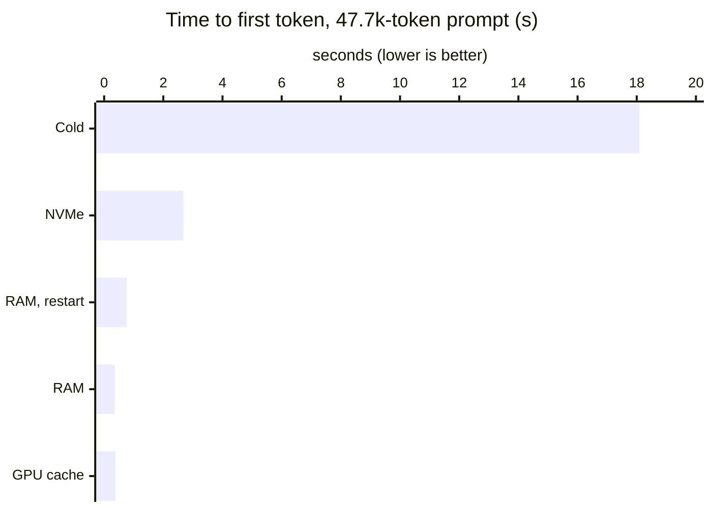

# Optional: LMCache KV cache in RAM and on NVMe

Not part of the default start. This page records what an external
[LMCache](https://github.com/LMCache/LMCache) server gave on this engine and
how it was wired, measured 2026-11-10 on 4× CMP 170HX (TP4, DFlash2).

## What it buys

Time to first token for the same ~47,700-token prompt, asked again in
different situations:

Cold: nothing cached · NVMe: LMCache server and vLLM both restarted ·
RAM, restart: vLLM restarted, LMCache kept running · RAM: GPU cache cleared ·
GPU cache: prefix still in vLLM's GPU cache.

| Situation | TTFT | vs cold |
|---|---:|---:|
| Cold, nothing cached | 18.09 s | 1× |
| Prefix still in vLLM's GPU cache | 0.38 s | 48× |
| GPU cache cleared, served from LMCache RAM | **0.36 s** | **50×** |
| vLLM restarted, LMCache server kept running (RAM) | **0.76 s** | **24×** |
| LMCache server and vLLM both restarted (NVMe only) | **2.68 s** | **6.8×** |

The GPU prefix cache holds what fits in the KV pool and is lost on every
restart. LMCache keeps evicted prefixes in a RAM tier (here 64–128 GB) and an
NVMe tier, both outside the vLLM process, so long agent and document
prompts stay fast after evictions, restarts and model reloads. The 0.76 s
after a restart includes the first request's kernel warm-up.

It also shortens restarts on hosts that use vLLM's built-in CPU offload: that
tier pins its RAM inside the engine at every start (~100 s for 128 GiB here);
with LMCache the memory belongs to the separate server and vLLM only connects.

## What it costs

| | Without | With LMCache |
|---|---:|---:|
| Cold prefill (3 × ~67k-token prompts, median of 9) | 3,141 tok/s | 2,565 tok/s (−18 %) |
| Decode, 1 / 16 users (own prompts, 400 tokens) | 170 / 633 tok/s | 175 / 628 tok/s |

Every prefilled chunk is written to the CPU tier, which costs prefill
throughput on cold prompts; decode is unaffected. Host RAM: the L1 size plus
~16 GB.

## How it was run

- LMCache 0.5.6 installed into a directory mounted into the engine image
  (`PYTHONPATH`); the engine image itself is unchanged.
- **Use the multi-process connector.** The in-process `LMCacheConnectorV1`
  fails on GLM-5.3's hybrid KDA + MLA model (no HMA support);
  `LMCacheMPConnector` from `lmcache.integration.vllm.lmcache_mp_connector`
  works. CacheBlend is not usable on this model (34 of 45 layers are
  recurrent KDA).
- **A separate server container** on the same four GPUs
  (`python -m lmcache.v1.multiprocess.http_server --l1-size-gb 64
  --chunk-size 1152 --eviction-policy LRU --l2-prefetch-policy retain
  --l2-adapter '{"type":"fs","base_path":"/kvcache"}'`), started before vLLM,
  with `--ipc shareable`; the vLLM container joins it with
  `--ipc container:<server> --pid container:<server>`.
- vLLM: `--kv-transfer-config '{"kv_connector":"LMCacheMPConnector",
  "kv_connector_module_path":"lmcache.integration.vllm.lmcache_mp_connector",
  "kv_role":"kv_both","kv_connector_extra_config":{"lmcache.mp.autostart":false,
  "lmcache.mp.host":"tcp://<server ip>","lmcache.mp.port":5555}}'`.
- `--chunk-size` must be a multiple of the 1,152-token KV block.
- `--l2-prefetch-policy retain` keeps what was read from NVMe in RAM; the
  default drops it after each use.
- **LoRA:** LMCache keys the cache by tokens only. If the same server serves
  a base model and a LoRA adapter (or two adapters), add the adapter name to
  the cache salt (`lmcache/integration/vllm/lmcache_mp_metadata.py`, where
  `cache_salt` is taken from the request), or they share each other's KV.
- NVMe files can be trimmed from outside (LRU by atime): the fs tier checks
  that each file exists on lookup, so a deleted file is a cache miss.
